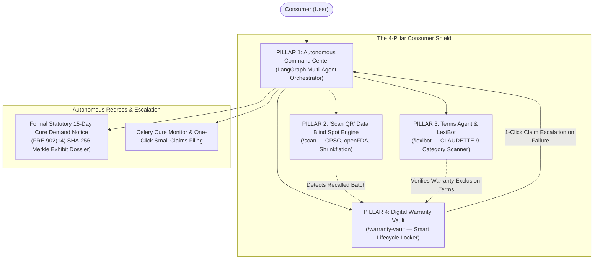

# Hackops-CR: AI-Powered Consumer Rights Platform

> **Warm White + Violet Editorial Landing Page and Consumer Workspace**
> An autonomous, full-stack consumer advocacy system designed to protect everyday shoppers from unfair adhesion contracts, lost warranty receipts, hazardous products, and denied warranty claims.

---

## Run the frontend

The repository includes a Next.js 15 / React 19 frontend and a FastAPI backend. The frontend still defaults to a local browser workspace; the API can also be run and used independently through its OpenAPI interface at `http://127.0.0.1:8000/docs`.

Requires Node.js 20.9+ and npm 11+.

```powershell
npm install
npm run dev
```

Open [the local app](http://127.0.0.1:3000). The default frontend experience needs no credentials or environment variables.

## Run the backend

The full local API stack uses FastAPI, PostgreSQL, Redis, and Celery for scheduled reminders. From the repository root:

```sh
docker compose up --build
```

The API is available at [http://127.0.0.1:8000](http://127.0.0.1:8000), with interactive docs at [http://127.0.0.1:8000/docs](http://127.0.0.1:8000/docs). For Python-only setup, see [backend/README.md](backend/README.md). Compose's default database password is for local development only.

To connect the browser UI, copy `frontend/.env.example` to `frontend/.env.local`, keep `NEXT_PUBLIC_BACKEND_URL=http://127.0.0.1:8000`, and restart Next.js. Cases, warranty items, document uploads, contract screening, and barcode lookups will then use the API. The browser stores its workspace bearer token in localStorage; this is a local single-device credential, not an account or protection from same-origin script access.

| Route | Screen |
|---|---|
| `/` | EvolveAI-inspired landing page |
| `/dashboard` | Consumer workspace overview |
| `/command-center` | Case ledger, intake, notice preview, and Markdown export |
| `/scan` | Camera / image barcode decoding, live catalog lookup, and save-to-vault |
| `/lexibot` | Keyword-based contract screening, SVG radar, and sentence search |
| `/warranty-vault` | Product passports, receipt storage, and warranty request drafts |
| `/research` | Searchable source library |

The current UI uses the warm-white (`#FAF9FD`) and violet (`#5B2BE7`) design introduced by the landing-page refresh, with white cards and muted supporting text. Inter and JetBrains Mono fonts are bundled locally.

The landing page uses a full-width layout without inheriting dashboard padding on mobile. Its footer has compact spacing between the navigation columns and copyright row, with 24 px of bottom padding on desktop and 20 px on tablet/mobile. The footer meets the bottom of the page without an extra blank gap. Layout was checked at 390 px, 768 px, and 1440 px widths with no horizontal overflow.

The About section aligns its copy with the workspace preview, separates paragraphs and the workspace link, and leaves space before the statistics. The Research callout uses a responsive grid for its icon, description, and action; topic labels wrap with explicit gaps so they never run together. Both sections stack cleanly on mobile.

Workspace records persist in localStorage. Uploaded PDF/PNG/JPEG files (up to 10 MB each) are stored in IndexedDB and hashed with WebCrypto SHA-256. Keep original documents: there is no cloud backup. Start with fictional sample records, or choose **Start a fresh workspace** from the workspace menu. Resetting replaces records; clearing site data also removes uploaded files.

With the backend URL configured, the browser app syncs cases, warranty items, and evidence, and uses backend contract screening and public-source product lookup. Without it, the local browser previews continue to work. The product scanner works without configuring FastAPI: a read-only Next.js route queries Open Food Facts (including its product-type redirects) and falls back to UPCitemDB for general products. UPCitemDB’s keyless free tier has a shared 100-request daily quota; successful upstream requests are cached for an hour. Missing listings and unavailable / rate-limited sources are displayed separately. Data attribution and source links accompany matches.

Camera decoding prefers native BarcodeDetector and falls back to a lazy-loaded ZXing reader. Camera access requires permission and HTTPS or localhost. PNG, JPEG, and WebP barcode photos up to 10 MB are decoded locally, including rotated images; photos are not uploaded. Manual GTIN / GS1 Digital Link entry is also supported. Scanned products prefill the vault form with name, brand, model, barcode, and available lot / serial metadata. When FastAPI is configured, its existing CPSC/openFDA lookup is retained as a separate recall check; a missing recall match is not a safety determination. The backend does not determine legal eligibility, dispatch notices, or send warranty requests.

For the implemented system design, see [architecture decisions, flows, and components](docs/architecture-decisions-flows-components.md). That guide reflects the current code; the longer product blueprint below includes planned concepts that are not part of the running backend.

### Checks

```powershell
npm run typecheck
npm run build
npm run test:e2e
```

Browser tests use an installed Microsoft Edge. To run on another platform, change `channel` in `playwright.config.ts` or install Chromium with Playwright and remove that channel setting.

---

## 1. System File Structure

The project is architected as a decoupled, production-grade monorepo combining a high-performance **Next.js 15 App Router** frontend with a **FastAPI + LangGraph** multi-agent backend:

```text
consumer-rights-platform/
├── frontend/                     # Next.js 15 App Router (React 19, Tailwind CSS)
│   ├── app/
│   │   ├── page.tsx              # Landing Page (EvolveAI style + Bento Grid)
│   │   ├── layout.tsx            # Root layout with warm-minimalist glass theme
│   │   ├── command-center/       # Feature 1: Stockroom-style Operations & Notice Generator
│   │   │   └── page.tsx
│   │   ├── scan/                 # Feature 2: Barcode & Recall Camera Scanner
│   │   │   └── page.tsx
│   │   ├── lexibot/              # Feature 3: T&C Analyzer & Grounded Chatbot
│   │   │   └── page.tsx
│   │   ├── warranty-vault/       # Feature 4: Digital Warranty Vault & Lifecycle Locker
│   │   │   └── page.tsx
│   │   ├── research/             # Academic corpus & statutory bibliography
│   │   │   └── page.tsx
│   │   └── api/                  # Next.js Edge proxy routes (streaming SSE to backend)
│   ├── components/
│   │   ├── visualizers/          # Pure SVG / Recharts components
│   │   │   ├── RiskRadar.tsx     # 5-Axis CLAUDETTE Contract Risk Radar
│   │   │   └── ExpiryTimeline.tsx# Warranty Lifecycle & Expiry Countdown Bar
│   │   ├── scanner/              # ZXing WebRTC camera scanner & GS1 parser
│   │   │   └── BarcodeCamera.tsx
│   │   ├── warranty/             # Digital Warranty Vault UI components
│   │   │   ├── ProductProfile.tsx# Digital product passport & repair history card
│   │   │   ├── ClaimWizard.tsx   # Authorized service channel & claim generator
│   │   │   └── DocLocker.tsx     # Drag-and-drop receipt, serial & invoice storage
│   │   ├── pdf/                  # @react-pdf/renderer dynamic court docket templates
│   │   │   └── StatutoryNoticePDF.tsx
│   │   ├── layout/               # Cruip Mosaic sleek sidebar & header components
│   │   │   ├── Sidebar.tsx
│   │   │   └── Header.tsx
│   │   └── ui/                   # Warm-minimalist glass cards, buttons, badges
│   └── lib/                      # Client utilities, WebCrypto hashing & SSE hooks
│       ├── api-client.ts
│       └── merkle.ts
│
└── backend/                      # FastAPI Python Service (Python 3.12+)
    ├── app/
    │   ├── main.py               # FastAPI application entrypoint & middleware
    │   ├── api/                  # REST API route routers
    │   │   ├── cases.py          # Claim management & status endpoints
    │   │   ├── scan.py           # Barcode resolution & recall queries
    │   │   ├── contracts.py      # Terms of service analysis endpoints
    │   │   └── warranty.py       # Warranty vault, OCR ingestion & claim endpoints
    │   ├── agents/               # LangGraph Multi-Agent Workflows
    │   │   ├── state.py          # Central case state definition (GrievanceState)
    │   │   ├── orchestrator.py   # Main LangGraph graph coordinator
    │   │   ├── issue_spotter.py  # UCC § 2-314 & MMWA statutory reasoning agent
    │   │   ├── evidence_ocr.py   # Docling multimodal receipt & serial parser
    │   │   ├── damage_calc.py    # 10% statutory pre-judgment interest calculator
    │   │   └── notice_drafter.py # Self-authenticating legal demand letter synthesizer
    │   ├── nlp/                  # Legal NLP models & heuristics
    │   │   ├── claudette.py      # CLAUDETTE 9-category contract classifier
    │   │   └── rag.py            # Sentence-chunked grounded RAG for LexiBot
    │   ├── integrations/         # Regulatory & manufacturer API clients
    │   │   ├── cpsc.py           # CPSC SaferProducts REST client
    │   │   ├── fda.py            # openFDA Enforcement API client
    │   │   ├── openfoodfacts.py  # Open Food & Products Facts v3 client
    │   │   ├── ifixit.py         # French Repairability Index & iFixit client
    │   │   └── service_network.py# Authorized manufacturer service network locator
    │   └── tasks/                # Celery / Redis asynchronous worker tasks
    │       ├── celery_app.py
    │       ├── cure_monitor.py   # Living 15-day cure window countdown state machine
    │       └── expiry_notifier.py# Automated warranty expiry alerts (30d / 7d / 24h)
    ├── pyproject.toml
    └── Dockerfile
```

---

## 2. Design Language & Visual System

```
┌────────────────────────────────────────────────────────────────────────┐
│   THEME: Modern Warm-Minimalist + Bento Grid + Glassmorphic Editorial  │
├────────────────────────────────────────────────────────────────────────┤
│  • Base Canvas: Deep warm obsidian (#0c0a09 / stone-950)               │
│  • Surfaces: Frosted dark stone cards with backdrop-blur-md           │
│  • Accents: Warm amber (#f59e0b) & terracotta (#d97706) highlights     │
│  • Active Protection: Emerald green (#10b981)                          │
│  • Safety Alerts / Expiry: Crimson red (#ef4444)                       │
│  • Typography: High-contrast sans (Inter) + Monospace (JetBrains Mono) │
└────────────────────────────────────────────────────────────────────────┘
```

* **Landing Page (`https://evolveai.chitkara.edu.in/`):** High-impact hero section with mission-driven editorial typography, floating badge pills, live stats counter (`$1,820+ Claimed & Recovered`, `42 Vault Items Protected`), and an asymmetric bento grid.
* **Command Center (`https://uicookies.com/demo/#stockroom`):** Operations dispatch view, case inventory ledger table, quick status pills (*Active Window*, *Refund Approved*), 60-second claim wizard, and 15-day cure countdown clock.
* **Feature Panels (`https://cruip.com/demos/mosaic/`):** Sleek collapsible sidebar, metric sparkline cards, 5-axis SVG Risk Radar, interactive grounded chatbot (LexiBot), and the Digital Warranty Vault product cards.

---

## 3. Four Core Pillars: Architecture & Engineering



---

### PILLAR 1: Autonomous Consumer Command Center (`/app/command-center/`)
* **What it does:** The user enters a grievance in plain words and drops in a receipt or chat screenshot (or imports it directly with 1 click from their Digital Warranty Vault). Autonomous multi-agent workers parse the facts, calculate statutory interest, and generate an authoritative 15-day cure demand notice.
* **UI Structure (`uiCookies Stockroom` style):**
  * **Operational Metric Ribbon:** Total claims value (`$1,820.13`), active notices (`2 Pending`), corporate AAA arbitration fee inversion exposure (`$10,200.00`), and a `94.2%` settlement rate.
  * **Stockroom Case Ledger:** Table tracking Case ID, SHA-256 Merkle root, Merchant Registered Agent, Product, Statutory Cause, and 15-day cure countdown.
  * **60-Second Claim Wizard:** Quick presets (*Smart TV display burnout*, *Illegal recurring subscription cancellation fees*, *Appliance motor failure*).
* **Backend Multi-Agent Stack (`backend/app/agents/`):**
  * `state.py`: Central `GrievanceState` (TypedDict) capturing factual predicates without LLM hallucination.
  * `evidence_ocr.py`: Docling / PDF.js parser extracting merchant, date, and amounts, with an arithmetic balance check:
    $$|\text{Subtotal} + \text{Tax} + \text{Shipping} - \text{Total}| < 0.02$$
  * `issue_spotter.py`: Forward-chaining rule engine evaluating **UCC § 2-314** (Implied Warranty of Merchantability), **ROSCA (15 U.S.C. § 8403)**, and **State UDAP/CLRA laws**. Disclaimers are invalidated under the Magnuson-Moss Warranty Act (15 U.S.C. § 2308).
  * `damage_calc.py`: Computes base purchase price + 10% statutory pre-judgment interest ($I = P \times \frac{0.10}{365} \times \Delta t$) + $18.50 mailing incidentals.
  * `notice_drafter.py`: Formulates an authoritative **Statutory Demand Letter** imposing a 15-day cure window. Highlights the **AAA Arbitration Fee Inversion Leverage** (warning merchant of \$3,400+ in mandatory corporate filing fees) and appends a **FRE 902(14) SHA-256 Merkle root** with a 28 U.S.C. § 1746 declaration.
  * `tasks/cure_monitor.py`: Celery task executing the living 15-day countdown state machine.

---

### PILLAR 2: "Scan QR" — Product History & Blind Spot Engine (`/app/scan/`)
* **What it does:** Scans any retail barcode to unmask active safety recalls, stealth package downsizing (*shrinkflation*), true corporate parentage, and repairability scores in under 1 second.
* **UI Structure (`Cruip Mosaic` style):**
  * **Hardware-Accelerated Scanner (`components/scanner/BarcodeCamera.tsx`):** W3C native `BarcodeDetector` (60fps GPU frame loop) with ZXing WebRTC fallback.
  * **GS1 Digital Link URI Parser:** Extracts `/01/{GTIN}/10/{LOT}/21/{SERIAL}` to trace specific contaminated manufacturing lots.
  * **Consumer Safety & Transparency Scorecard (0–100):** Visual letter grade badge (A to F) with sub-scores for Safety (30%), Purity (25%), Value Integrity (15%), Repairability (15%), and Corporate Ownership (15%).
  * **1-Click Vault Add:** Easily saves scanned product and packaging records directly into Pillar 4's Digital Warranty Vault.
* **Backend Integrations (`backend/app/integrations/`):**
  * `cpsc.py`: Queries the CPSC Recall REST API (`saferproducts.gov`) by UPC and model.
  * `fda.py`: Queries the openFDA Enforcement API for food, cosmetic, and drug recalls (Class I, II, III).
  * `openfoodfacts.py`: Queries Open Food Facts v3 to detect **Shrinkflation** ($\Delta W \ge 3.0\%$ with constant price) and **Skimpflation** (Rank-Biased Overlap on ingredient degradation).
  * `ifixit.py`: Queries the French Repairability Index (`indicereparabilite` via `data.gouv.fr`) for official 0–10 electronics repair scores.

---

### PILLAR 3: Terms & Conditions Agent & Interactive LexiBot (`/app/lexibot/`)
* **What it does:** Ingests terms of service and privacy policies, classifies unfair terms across 9 categories, scores fairness, and answers user questions with verified sentence citations.
* **UI Structure (`Cruip Mosaic` style):**
  * **5-Axis SVG Risk Radar (`components/visualizers/RiskRadar.tsx`):** Pure React/SVG radar chart projecting *Dispute Autonomy*, *Account Security*, *Liability Balance*, *Data Sovereignty*, and *Contract Transparency*.
  * **CLAUDETTE Flagged Clauses Drawer:** Lists predatory clauses with severity badges and legal explanations.
  * **Interactive LexiBot Chat Window:** Conversational assistant testing consumer hypotheses (*"Can I cancel anytime?"*, *"Will they auto-renew?"*) with strict NLI grounding.
* **Backend NLP Engine (`backend/app/nlp/`):**
  * `claudette.py`: Classifies sentences across the 9 canonical unfair terms (unilateral changes, arbitration waivers, liability caps) using sub-linear saturation scoring:
    $$\text{Penalty}_c = w_c \cdot \min(100, 30 \cdot \ln(1 + n_c))$$
  * `rag.py`: Segments documents into immutable sentence IDs (`[S-001]`). Employs hybrid retrieval (dense vectors + BM25). A verification guard ensures every bot assertion terminates with a verified verbatim citation `[Clause X.X: "..."]`.

---

### PILLAR 4: Digital Warranty Vault & Lifecycle Locker (`/app/warranty-vault/`)
* **What it does:** A smart, AI-powered digital locker that allows consumers to securely store and manage all product-related documents (purchase invoices, warranty cards, bills, QR codes, serial numbers, extended warranty certificates, and repair receipts). Eliminates the risk of lost receipts or forgotten deadlines.
* **UI Structure (`Cruip Mosaic` style):**
  * **Vault Overview Dashboard:**
    * Active Warranties Protected (`14 Items`) | Upcoming Expirations (`2 in <30 Days`) | Total Protected Asset Value (`$6,840.00`) | Claim Eligibility Ratio (`100% Documented`).
  * **Digital Product Profile Card (`components/warranty/ProductProfile.tsx`):**
    * High-resolution photo, product name, brand, model number, serial number, purchase date, merchant/seller details, and active warranty duration.
    * Real-time **Expiry Countdown Bar (`components/visualizers/ExpiryTimeline.tsx`)** showing remaining coverage days with color-coded alerts (Green: Active, Amber: Expiry in <30d, Red: Expired).
    * Embedded document viewer for original PDF invoices, warranty certificates, and repair service notes.
  * **AI Ingestion Modal (`components/warranty/DocLocker.tsx`):**
    * Multi-modal upload: scan a QR code, upload a photo or PDF receipt, or snap a bill with the camera.
    * Instant AI extraction: auto-fills Product Name, Brand, Model, Serial Number, Purchase Date, Seller Name, and Warranty Period (e.g. "12 Months Limited", "3 Years Parts & Labor").
  * **1-Click Claim Generator & Service Locator (`components/warranty/ClaimWizard.tsx`):**
    * When a product malfunctions, user clicks `File Warranty Claim`.
    * Checks warranty terms and confirms statutory claim eligibility under the **Magnuson-Moss Warranty Act (15 U.S.C. § 2302)** and **UCC § 2-314**.
    * Automatically locates the manufacturer's authorized service centers and warranty claim portals.
    * Generates a pre-compiled **Warranty Claim Packet** bundling the proof of purchase, serial photo, and defect notice.
    * **Seamless Command Center Escalation:** If the manufacturer or store denies the warranty or fails to repair, one click transfers the entire vault dossier directly into Pillar 1's Command Center to compile a formal 15-day statutory demand letter!
* **Backend Vault Engine (`backend/app/api/warranty.py` & `agents/evidence_ocr.py`):**
  * `evidence_ocr.py`: Specialized Docling parser extracting serial numbers (OCR regular expressions: `\b[A-Z0-9]{8,16}\b`), model numbers, line-item purchase totals, and warranty terms.
  * `integrations/service_network.py`: Database resolving authorized manufacturer service endpoints and warranty claim emails (AppleCare, Samsung Care, Whirlpool Service, Sony Support).
  * `tasks/expiry_notifier.py`: Celery task executing scheduled cron checks against the user's vault items, firing automated reminder notifications at 30 days, 7 days, and 24 hours prior to warranty expiration.

---

## 4. Academic Research Foundation & Citation Matrix

| Feature | Academic Paper / Legal Rule | Author / Venue | Key Finding & Operationalization | Link |
|---|---|---|---|---|
| **Command Center** | *Access to Consumer Remedies in the Squeaky Wheel System* | Amy J. Schmitz (*Pepperdine Law Review*) | Proves companies systematically settle only with aggressive consumers; automated statutory notices equalize power. | [Paper](https://digitalcommons.pepperdine.edu/plr/vol39/iss2/2/) |
| **Command Center** | *Mass Arbitration & Fee Inversion* | J. Maria Glover (*Stanford Law Review*) | Mandatory arbitration costs companies \$3,400+ per case; weaponizes fee liability to compel refunds. | [Paper](https://www.stanfordlawreview.org/print/article/mass-arbitration/) |
| **Command Center** | *The Fourth Party in Algorithmic Dispute Resolution* | Wing, Martinez, Katsh, & Rule (*Negotiation Journal*) | Establishes autonomous computational agents as a "Fourth Party" that diagnoses claims and structures redress. | [DOI](https://doi.org/10.1111/nejo.12350) |
| **Scan QR** | *The Market for "Lemons": Quality Uncertainty* | George A. Akerlof (*Quarterly Journal of Economics*) | Information asymmetry leads to adverse selection; instant barcode scanning collapses consumer search costs. | [DOI](https://doi.org/10.2307/1879431) |
| **Scan QR** | *Digital Product Passports for a Circular Economy (ESPR)* | European Union (*Regulation EU 2024/1781*) | Global standard for tracking product history, repairability, and instantaneous hazardous recall alerts via 2D barcodes. | [EUR-Lex](https://eur-lex.europa.eu/eli/reg/2024/1781/oj) |
| **Terms Agent** | *Project CLAUDETTE: Automated Unfair Clause Detection* | Lippi et al. (*Artificial Intelligence and Law*) | Benchmark machine learning taxonomy for classifying 9 categories of unfair terms in consumer contracts. | [DOI](https://doi.org/10.1007/s10506-019-09243-2) |
| **Terms Agent** | *The Cost of Reading Privacy Policies* | McDonald & Cranor (*I/S: Journal of Law and Policy*) | Quantified that reading policies takes 244 hours per year (\$365B economic friction); AI readers are essential. | [Paper](https://kb.osu.edu/handle/1811/72839) |
| **Terms Agent** | *Make Privacy Policies Longer and Appoint LLM Readers* | Pałka et al. (*Artificial Intelligence and Law 2025*) | Proves consumers should appoint dedicated AI reader agents to safeguard their rights rather than reading agreements. | [DOI](https://doi.org/10.1007/s10506-025-09442-0) |
| **Warranty Vault** | *Magnuson-Moss Warranty Act (15 U.S.C. §§ 2301–2312)* | U.S. Federal Trade Commission & Congress | Mandates clear warranty disclosure, bans deceptive warranty disclaimers (§ 2308), and outlaws repair tie-ins (§ 2302(c)). | [FTC Guidance](https://www.ftc.gov) |
| **Warranty Vault** | *UCC § 2-607(3)(a) & Evidence Preservation in Sales* | American Law Institute & ULC | Imposes strict burden on buyers to preserve purchase proof and provide timely notice of breach to preserve remedy. | [ALI UCC](https://www.law.cornell.edu/ucc/2/2-607) |

---

## 5. UI Recreation Master Prompt & Design System Specification

> **Copy-Paste Instructions for Frontend Engineering / AI Agents:**  
> Use the prompt below to recreate the full-stack user interface for the **Hackops-CR** consumer advocacy platform.

```markdown
### SYSTEM ROLE & OBJECTIVE
You are an expert Principal Frontend Architect and UI/UX Designer specializing in Next.js 15 App Router, React 19, Tailwind CSS v3/v4, Framer Motion, and Recharts/Lucide. 

Your objective is to implement the complete, responsive frontend for **Hackops-CR: The Autonomous Consumer Rights & Warranty Intelligence Platform**.

### CORE DESIGN REFERENCES & FUSION
1. **Landing Page Architecture (`https://evolveai.chitkara.edu.in/`):**
   - High-impact editorial hero section with bold headline typography, illuminated glow badge pills, real-time dynamic statistics strip, and an asymmetric Bento Grid showcase.
   - Sticky blurred glassmorphic navbar with active route pills and live system status indicators.
2. **Operations & Dispatch UI (`https://uicookies.com/demo/#stockroom`):**
   - Clean, high-density inventory/dispatch ledger table aesthetic for the **Command Center**.
   - Metric KPI ribbon, quick intake forms with 60-second presets, and living 15-day statutory countdown status bars.
3. **Application Chrome & Feature Panels (`https://cruip.com/demos/mosaic/`):**
   - Sleek dark slate collapsible sidebar with categorized navigation, notification badges, and active amber accent lines.
   - Interactive data visualizers: 5-Axis SVG Contract Risk Radar, Warranty Expiry Countdown Timelines, and grounded chatbot drawers with verified clause citations.

### THEME SPECIFICATION: Modern Warm-Minimalist + Bento Grid + Glassmorphic Editorial
- **Canvas / Background:** Deep warm obsidian `#0c0a09` (`stone-950`), subtle background radial mesh glow in `#1c1917` (`stone-900`).
- **Glassmorphic Card Surfaces:** `rgba(28, 25, 23, 0.70)` (`stone-900/70`) with `backdrop-blur-md`, delicate 1px border `border-stone-800/80`, and soft outer glow `shadow-xl shadow-black/40`.
- **Primary Accent Palette:** Warm Amber `#f59e0b` (`amber-500`) and Terracotta `#ea580c` / `#d97706` (`amber-600` / `orange-600`) for primary buttons, active tabs, and key focus rings.
- **Status Palettes:**
  - *Active Protection / Valid:* Emerald green `#10b981` (`emerald-500`), subtle bg `emerald-500/10`, border `emerald-500/30`.
  - *Expiring (<30 Days) / Caution:* Amber `#f59e0b` (`amber-500`), bg `amber-500/10`, border `amber-500/30`.
  - *Recalled / Expired / Predatory:* Rose / Crimson `#f43f5e` (`rose-500`), bg `rose-500/10`, border `rose-500/30`.
- **Typography:**
  - Headlines & Body: `Inter` or `Plus Jakarta Sans`, high contrast `#fafaf9` (`stone-50`) titles, `#d6d3d1` (`stone-300`) body, `#a8a29e` (`stone-400`) captions.
  - Serials, Hashes, & Statutes: `JetBrains Mono` or `ui-monospace` for SHA-256 Merkle roots, legal citations (UCC § 2-314), and product serial numbers.

### REPOSITORY DIRECTORY LAYOUT
consumer-rights-platform/
├── frontend/                     # Next.js 15 App Router
│   ├── app/
│   │   ├── page.tsx              # EvolveAI Landing Page & Bento Showcase
│   │   ├── layout.tsx            # Root Layout with Glass Theme & Nav
│   │   ├── command-center/       # Pillar 1: Multi-Agent Hub & Notice Generator
│   │   │   └── page.tsx
│   │   ├── scan/                 # Pillar 2: Barcode & Recall Camera Scanner
│   │   │   └── page.tsx
│   │   ├── lexibot/              # Pillar 3: T&C Analyzer & Grounded Chatbot
│   │   │   └── page.tsx
│   │   ├── warranty-vault/       # Pillar 4: Digital Warranty Vault & Lifecycle Locker
│   │   │   └── page.tsx
│   │   ├── research/             # Academic corpus & statutory bibliography
│   │   │   └── page.tsx
│   │   └── api/                  # Edge proxy routes for streaming backend SSE
│   ├── components/
│   │   ├── visualizers/          # Recharts / SVG visualizers (RiskRadar, ExpiryTimeline)
│   │   ├── scanner/              # WebRTC camera scanner & GS1 barcode parser
│   │   ├── warranty/             # ProductProfile, ClaimWizard, DocLocker
│   │   ├── pdf/                  # @react-pdf/renderer dynamic demand letter templates
│   │   └── layout/               # Cruip Mosaic Sidebar, Header, Breadcrumbs
│   └── lib/                      # WebCrypto Merkle hashing & API clients
│
└── backend/                      # FastAPI Python Service
    ├── app/
    │   ├── api/                  # REST endpoints (cases, scan, contracts, warranty)
    │   ├── agents/               # LangGraph Multi-Agent Workflows
    │   │   ├── state.py          # Central case state (GrievanceState)
    │   │   ├── issue_spotter.py  # UCC / CPA statutory reasoning agent
    │   │   ├── evidence_ocr.py   # Docling receipt & serial parser
    │   │   ├── damage_calc.py    # Legal interest calculator
    │   │   └── notice_drafter.py # Legal demand letter synthesizer
    │   ├── nlp/                  # CLAUDETTE 9-category contract classifier
    │   ├── integrations/         # CPSC, Open Food Facts, iFixit, Service Networks
    │   └── tasks/                # Celery scheduler (15-day cure window & expiry notifications)
    ├── pyproject.toml
    └── Dockerfile

### REQUIRED VIEWS & COMPONENT BEHAVIOR
1. **Landing Page (`app/page.tsx` - EvolveAI Inspiration):**
   - Header with platform brand logo, live status dot, and navigation items.
   - Hero: Editorial headline ("Equalizing Consumer Power Through Autonomous Legal Intelligence"), sub-copy explaining the four pillars, CTA buttons ("Launch Command Center", "Explore Features").
   - Stats ticker: Real-time animated counters for Monies Claimed, Arbitration Fees Avoided, Products Protected, and Clauses Audited.
   - Asymmetric Bento Grid: 4 interactive cards representing the 4 core pillars with interactive hover states and feature badges.
2. **Autonomous Command Center (`app/command-center/page.tsx` - Stockroom Inspiration):**
   - Metric Banner: Total Disputed Value, Active Notices, AAA Corporate Arbitration Leverage Exposure, Recovery Rate.
   - Quick Grievance Dispatcher: Plain-language text prompt, OCR dropzone for receipts/invoices, or "Import from Digital Warranty Vault" 1-click button. Preset buttons for quick dispute setup.
   - Stockroom Ledger Table: Columns for Case ID, Product & Serial, Registered Agent, Cause of Action, SHA-256 Merkle Hash badge, 15-Day Cure Countdown progress bar, and action buttons.
   - Live Notice Preview & Download: Dynamic generation of legal demand letter citing AAA fee inversion (\$3,400+ corporate cost) and 28 U.S.C. § 1746 verification.
3. **Scan QR Engine (`app/scan/page.tsx` - Cruip Mosaic Inspiration):**
   - Video camera viewfinder with scanner reticle and manual UPC input fallback.
   - Instant Transparency Scorecard (0–100) with letter grade (A–F).
   - Breakdown cards: Active Recall Status (CPSC / openFDA), Shrinkflation / Weight Change Detection, French Repairability Index (0–10), and Corporate Parentage.
   - 1-Click "Save Product to Warranty Vault" button.
4. **Terms Agent & LexiBot (`app/lexibot/page.tsx` - Cruip Mosaic Inspiration):**
   - URL input or raw terms paste box with instant audit trigger.
   - 5-Axis SVG Risk Radar (`components/visualizers/RiskRadar.tsx`) visualizing Dispute Autonomy, Account Security, Liability Balance, Data Sovereignty, and Contract Transparency.
   - CLAUDETTE Flagged Clauses Drawer with severity badges (High/Medium/Low) and plain-English breakdown.
   - Grounded LexiBot Chat: Split-panel chat interface testing queries with mandatory citation anchors `[Clause X.X: "..."]`.
5. **Digital Warranty Vault (`app/warranty-vault/page.tsx` - Cruip Mosaic Inspiration):**
   - Top KPI ribbon: Active Protected Items, Upcoming Expirations (<30 Days), Protected Asset Value, Documented Claims Ratio.
   - Product Grid / Passport Cards: Product image, Brand, Model, Serial number, Purchase Date, Merchant, and Expiry Countdown Bar (`components/visualizers/ExpiryTimeline.tsx`).
   - Document Locker Drawer: Visual modal displaying stored invoices, warranty certificates, and repair records.
   - AI Ingestion Modal: Drag-and-drop bill/receipt scanner with auto-extracted OCR fields.
   - 1-Click Warranty Claim Wizard: Statutory eligibility confirmation (Magnuson-Moss Warranty Act § 2302), authorized repair locator, auto-generated claim dossier, and 1-click escalation to Pillar 1 Command Center if warranty is refused.
```

